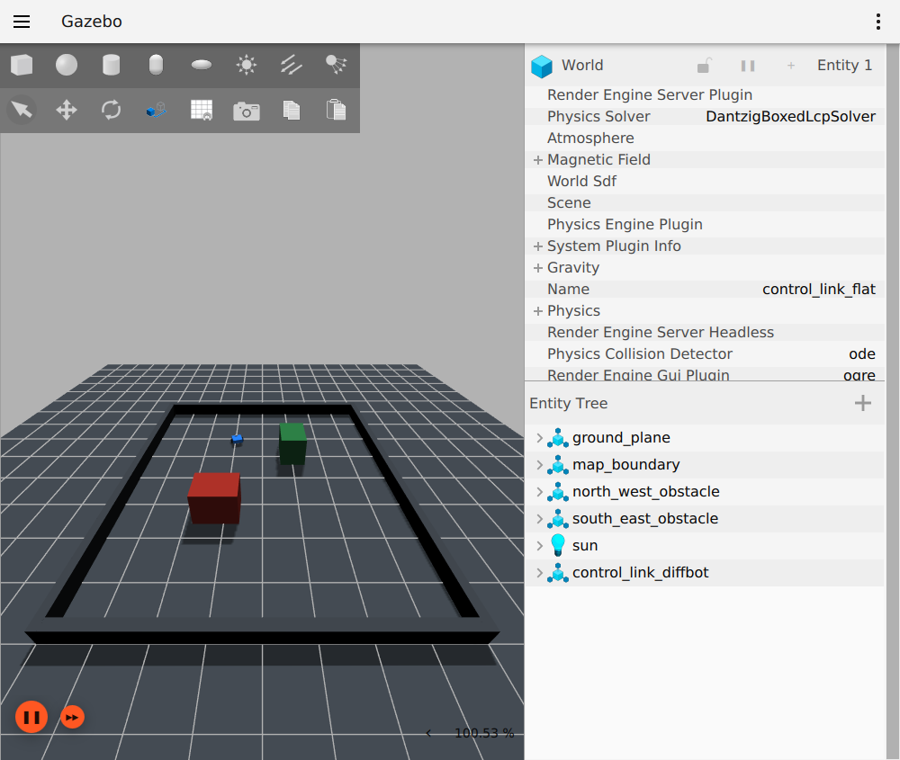

# ControlLink Guardian

ControlLink Guardian 是面向低速无人车和仓储 AMR 的 C++/ROS2 控制通信网关，位于 Nav2、遥控或规划控制模块与机器人、车辆执行层之间

它将多个控制来源收敛为唯一的 canonical control output，并集中处理通信契约、DDS QoS、来源身份、命令合法性、时效性、仲裁、故障降级与恢复，避免同一套控制安全规则分散在上游节点和不同执行平台中

## 运行链路

```text
Nav2 / teleop / planning-control
  -> ingress adapters
  -> Contract + QoS endpoint boundary
  -> source binding and command validation
  -> latest valid snapshots and source arbitration
  -> health state machine
  -> fixed-rate canonical output
  -> robot / vehicle adapters
  -> VehicleState + diagnostics + rosbag2
```

## 核心能力

- YAML 驱动的 Topic、QoS、来源策略、超时、速度边界和关键 endpoint 契约
- DDS Request-vs-Offered compatibility 与项目 exact policy 分层检查
- publisher GID generation、严格递增 sequence、ROS time 新鲜度与 steady-clock lease 校验
- priority、命令年龄和 `source_id` 组成的确定性仲裁，以及 teleop 接管与 fallback
- Lifecycle 资源管理、双 callback group、结构化 GatewayState、SourceStatus、VehicleState 和 diagnostics
- 固定 50Hz canonical 输出，非 ACTIVE 数据面状态持续发布软件层 HOLD
- adapter 本地看门狗和执行端结构化健康反馈，覆盖网关停发与平台反馈超时
- 基于语义配置哈希的 Contract 身份追踪，以及 Lifecycle 事务式重配置、Graph 验证和失败回滚
- 决策事件 JSONL 记录与离线确定性回放，复用生产 Validator、Arbiter 和 GatewayStateMachine
- 可由 ros2_control 加载的 mock `hardware_interface::SystemInterface`，支持执行链和故障传播验证

## 两种运行 Profile

```text
Robot
Nav2 / teleop
  -> Twist ingress
  -> Guardian
  -> ros2_control adapter
  -> diff_drive_controller
  -> Gazebo

ADAS
planning / teleop
  -> Guardian
  -> SocketCAN adapter
  -> vcan0 0x180 / 0x280
  -> vehicle simulator
```

Robot 与 ADAS 复用相同的 Contract、命令校验、来源仲裁和状态治理核心，平台差异只留在 ingress、执行 adapter 与 bringup 边界

## 外部规划程序接入

ADAS Profile 可选使用 EdgeRuntime、SOME/IP 或 gRPC 将外部规划或轨迹跟踪结果接入同一条控制链；`planning_transport=ros2|edge|someip|grpc` 显式互斥，ROS teleop 仍经同一 Gateway 仲裁。SOME/IP 与 gRPC 复用 ROS-free `control_link_network_ingress` 的 schema、session/epoch、单槽 pending 和原 command codec，不复制 Gateway 的 Binding、Validator、Arbiter 或 StateMachine。

### EdgeRuntime 同机接入

```text
外部规划程序
  -> control_link_edge_client SDK
  -> EdgeRuntime SPSC latest-value channel
  -> edge_planning_bridge_node
  -> /control_link/input/planning
  -> Guardian -> SocketCAN/vcan -> vehicle feedback
  -> EdgeRuntime feedback channel -> 外部规划程序
```

`control_link_edge_protocol` 是不依赖 ROS2 的定长 codec；可选的 `control_link_edge_client` 是由已安装 EdgeRuntime 支撑的 C++ SDK，提供 `open`、反馈读取、`current_session`、`status`、`submit`、`heartbeat` 和 `close`。`edge_protocol/examples/edge_planning_sdk_consumer` 是独立 CMake consumer，可在未 source ROS2 的环境中通过 `find_package(control_link_edge_client CONFIG REQUIRED)` 消费安装 SDK。

SDK 默认单 owner。每个目标必须绑定当前 session、由调用者提供 SYSTEM 时间戳和该 session 内递增的业务 sequence；session 变化时旧目标拒绝且不会自动重发或重新盖章。输入值是固定车体坐标中的 `linear_velocity_mps` 与 `angular_velocity_radps`，`NORMAL/HOLD` 映射沿用现有 Contract。它不实现规划算法、轨迹跟踪、Ackermann steering angle/acceleration 转换，也不宣称 Autoware 或 Apollo 接入。

### SOME/IP 网络接入

```text
外部规划程序 -> control_link_someip_transport SDK
  -> SOME/IP TCP + Service Discovery
  -> someip_planning_bridge_node -> /control_link/input/planning
  -> Guardian -> SocketCAN/vcan -> 独立 Gateway/Source/Vehicle 状态
  -> SOME/IP status events / GetStatus -> 外部规划程序
```

可选 C++ SDK 使用 vsomeip 与 Protobuf，复用同一 ROS-free 64B command codec；提供 `start`、`wait_available`、`open`、`keep`、`submit`、`get_status`、`status`、`set_status_subscription`、`close` 和 `stop`。SDK 单 owner，独立示例 [someip_planning_consumer](someip_transport/examples/someip_planning_consumer/CMakeLists.txt) 可在未 source ROS2 的环境中通过 `find_package(control_link_someip_transport CONFIG REQUIRED)` 链接 `ControlLink::control_link_someip_transport`，不依赖 EdgeRuntime。

示例默认每 50ms 计算新目标、每 1000ms 发送独立 Keep；Keep 只维护网络 holder，不刷新命令时间或 lease。目标保留调用者的原始 SYSTEM 时间戳和当前 session 的业务 sequence；换 session 后重新计算目标，不为旧目标换 token、重盖时间或自动重发。SD available、`submission_ready`、协议回复均不等于 Gateway 接受或 planning ACTIVE；Gateway、SourceStatus、VehicleState 反馈保留各自时间与 validity，不是原子状态或任务 ACK。

adapters 构建时显式开启 `CONTROL_LINK_ENABLE_SOMEIP=ON` 才提供 bridge；launch 使用 `planning_transport:=someip`，必须提供 server 的绝对 `vsomeip_config_path`，并使用完整 `config_root` 下的网络 YAML。外部 client 另行提供自己的 JSON、application identity 与网络配置，`someip_configure` 可从唯一 YAML 生成 JSON。SDK/构建/启动接口、网络夹具条件与限制见 [网络接入契约](docs/17_network_protocol_contracts.md)。

新握手显式绑定 GetStatus 观察到的开立域（服务实例与非回绕代次）；Open/Keep/Close 使用同一域，响应丢失重试不更换域。串行释放旧 publisher 后先关闭旧域、再回收其记录，因此有限退役键预算不再限制服务总会话次数；缺域或旧域请求明确拒绝。读取公开域不取得控制资格，也不承担认证。

### gRPC 异步网络接入

```text
外部规划程序 -> control_link_grpc_transport SDK
  -> 双向 OpenSession control stream + 短 unary Submit
  -> grpc_planning_bridge_node -> /control_link/input/planning
  -> Guardian -> SocketCAN/vcan -> 独立 Gateway/Source/Vehicle 状态
  -> 只读 SubscribeStatus / GetStatus -> 外部规划程序
```

可选 C++ target `ControlLink::control_link_grpc_transport` 使用锁定 gRPC/Protobuf 的真实异步接口和 CompletionQueue；公共类型 `control_link::grpc_transport::GrpcClient` 提供 `start/wait_available/open/keep/close/submit/get_status/get_capabilities/set_status_subscription/status/half_close/cancel_control/stop`。独立 [grpc_planning_consumer](grpc_transport/examples/grpc_planning_consumer/CMakeLists.txt) 通过 `find_package(control_link_grpc_transport CONFIG REQUIRED)` 消费同一 SDK，不需 ROS2、EdgeRuntime 或 vsomeip；message 与 gRPC stub 由同一 `.proto` 声明式生成和安装。

唯一 holder 绑定存活 control RPC 和两个幂等键，第二 RPC 即使复制键也不能取得当前 token；只读查询、订阅取消和 HTTP/2 重连不旋转控制代次。半关闭、取消、绝对 deadline 或本地停止撤销 epoch，旧 completion 和旧目标不能越过新 session；Keep 不刷新业务时间或 lease。网络 CQ owner 与串行 ROS resource owner 分离，控制及每个只读订阅只保留 latest slot。停止先撤资格、取消并唤醒，再由非 CQ 线程关闭 server、排空 tags、join，最后释放 handles。

adapters 显式开启 `CONTROL_LINK_ENABLE_GRPC=ON` 提供 `grpc_planning_bridge_node`；launch 的 `planning_transport:=grpc` 要求该 executable 已安装，配置取完整 `config_root` 下的网络 YAML，不需要 vsomeip JSON。`grpc_planning_client` 与独立 consumer 共用示例循环，默认命令 50ms、Keep 1000ms；连接可用、RPC receipt 和 session ready 不等于 Gateway accepted、planning ACTIVE 或车辆执行 ACK。SDK/关闭及安装责任见 [网络接入契约](docs/17_network_protocol_contracts.md)，实际验收范围见 [阶段台账](docs/00_mvp_evidence_plan.md)。

新控制 RPC 的 Open 显式使用 GetCapabilities 返回的当前开立域；Keep/Close 和同 live RPC 的幂等重试冻结此域。绝对 stream deadline 保留，终止后必须重新取得新域、计算新目标，不把旧握手或旧目标自动套入新会话；旧域拒绝与有界回收复用同一公共入口规则。

### 默认关闭与构建边界

`CONTROL_LINK_ENABLE_SOMEIP`、`CONTROL_LINK_ENABLE_GRPC`、`CONTROL_LINK_ENABLE_MQTT` 默认关闭；关闭时原 ROS2/Edge 链不查找或链接这些网络依赖。SOME/IP 与 gRPC 开启选择各自真实协议 target，原公共 Gateway/Contract/Edge SDK 导出不引入网络依赖。MQTT 仅保留默认 OFF 的只读 telemetry 契约和依赖探测，没有生产服务、client 或车辆控制入口。独立 [依赖探测](tools/protocol_dependency_probe/CMakeLists.txt) 始终只做依赖检查；target 存在或配置成功不能证明网络通信或车辆控制闭环已通过验收。

## Robot 仿真闭环

Robot Profile 使用 Nav2、AMCL、tf2、ros2_control 和 Gazebo，Gateway 的 canonical command 只能经执行 adapter 进入 `diff_drive_controller`



## 运行演示

### Robot Profile

[](assets/机器人控制闭环演示_1080p60.mp4?raw=1)

[打开 Robot 1080p60 H.264/MP4 原片](assets/机器人控制闭环演示_1080p60.mp4?raw=1)

### ADAS Profile

[](assets/ADAS控制闭环演示_1080p60.mp4?raw=1)

[打开 ADAS 1080p60 H.264/MP4 原片](assets/ADAS控制闭环演示_1080p60.mp4?raw=1)

两段动态预览由对应的 1080p60 原片生成，分别展示 Robot 与 ADAS 运行链路中的网关状态、控制输入、canonical 输出和执行端反馈

## 快速运行

在已安装 ROS2 Humble 与项目依赖的 Ubuntu 环境中构建工作区：

```bash
cd ros2_ws
source /opt/ros/humble/setup.bash
colcon build --symlink-install --cmake-args -DCMAKE_BUILD_TYPE=RelWithDebInfo
source install/setup.bash
```

启动 Robot/Nav2/Gazebo 闭环：

```bash
ros2 launch control_link_bringup robot_demo.launch.py
```

首次创建 vcan 设备后启动 ADAS 软件闭环：

```bash
sudo modprobe vcan
sudo ip link add dev vcan0 type vcan
sudo ip link set vcan0 up
ros2 launch control_link_bringup adas_vcan_demo.launch.py can_interface:=vcan0
```

## 虚拟机性能基线

测试环境为 ROS2 Humble、Fast DDS、VMware 和 vcan，三轮独立运行均包含 30 秒 warm-up 与 300 秒 measurement，聚合结果通过配置、样本量、运行连续性和 artifact SHA-256 校验

| 指标 | 聚合样本数 | 三轮结果范围 |
|---|---:|---:|
| canonical output interval mean | 44,997 | 19.99996 - 20.00023 ms |
| canonical output interval p99 | 44,997 | 20.66683 - 20.69130 ms |
| canonical output absolute jitter p99 | 44,997 | 0.75989 - 0.79229 ms |
| command callback-to-output p99 | 22,500 | 6.65729 - 20.06467 ms |
| CAN control/state round-trip p99 | 40,869 | 20.92152 - 20.96797 ms |
| source switch external observation | 3 | 133.4353 - 739.1794 ms |

| 进程 | CPU mean | CPU max | RSS max |
|---|---:|---:|---:|
| Gateway | 4.97% - 5.24% | 6.01% - 7.00% | 42,372 - 42,404 KiB |
| SocketCAN Adapter | 2.51% - 2.79% | 4.00% - 4.00% | 42,216 - 42,380 KiB |
| Vehicle Simulator | 0.58% - 0.59% | 2.00% - 2.00% | 42,004 - 42,112 KiB |
| Control Source | 0.81% - 0.85% | 2.00% - 2.00% | 39,400 - 39,736 KiB |
| External Observer | 2.73% - 3.00% | 4.00% - 5.00% | 43,348 - 43,608 KiB |

source switch 每轮只有一个外部观察样本，起点不是 Gateway 内部 challenger 计时点，因此只展示范围，不作为稳定时延分布结论；全部数据只描述当前虚拟机软件闭环，不外推为实车、物理 CAN 或硬实时性能

## 技术栈

| 层次 | 技术与接口 |
|---|---|
| C++ 工程 | C++17、CMake、ament_cmake、colcon、RAII、标准库并发与 filesystem |
| ROS2 运行时 | ROS2 Humble、rclcpp Lifecycle、MultiThreadedExecutor、callback group、ROS Graph、rosidl、diagnostics |
| DDS 通信 | Fast DDS、RMW、QoS Request-vs-Offered compatibility、endpoint GID、SHM transport |
| 机器人系统 | Nav2、AMCL、tf2、ros2_control、pluginlib、diff_drive_controller、Gazebo |
| Linux 与车辆链路 | SocketCAN/PF_CAN、vcan、poll、eventfd、独立 I/O thread、CRC 与 rolling counter |
| 配置与可靠性 | yaml-cpp、OpenSSL SHA-256、JSONL decision trace、确定性回放、事务式重配置与回滚 |
| 测试与证据 | GTest、launch_testing、pytest、rosbag2、ldd -r、GitHub Actions |

## 能力边界

- Guardian 是控制通信与状态治理组件，不实现导航、感知、预测、规划或控制算法
- 普通 ROS Topic 和软件 HOLD 不承担硬实时急停或功能安全职责
- ADAS Profile 使用项目自有 vcan demo protocol，不冒充 OEM CAN、AUTOSAR 或量产车辆接口
- Fast DDS SHM transport 不等于应用层 zero-copy

## Package 边界

```text
control_link_interfaces  运行时消息定义
control_link_contract    YAML model/parser、QoS 与 endpoint compatibility
control_link_gateway     Lifecycle、校验、仲裁、状态机、调度与 diagnostics
control_link_adapters    Robot/ADAS 输入和执行平台适配
control_link_bringup     launch、URDF、地图、仿真、录制与回放编排
```

```text
公共控制主线
  /control_link/input/<source>
  -> command validation
  -> source arbitration
  -> /control_link/output/control_cmd

结构化反馈
  /control_link/state
  /control_link/source_status
  /control_link/vehicle_state
  /diagnostics
```

License: Apache-2.0
